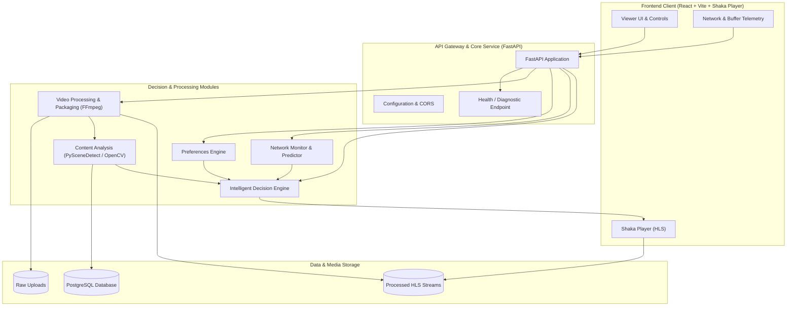

# StreamWise Architecture Documentation

StreamWise is an intelligent video streaming optimization system designed to deliver high-perceived-quality video while minimizing bandwidth consumption and rebuffering events. Unlike traditional Adaptive Bitrate (ABR) algorithms that react solely to throughput and buffer levels, StreamWise incorporates video content complexity and viewer preferences to make granular, segment-level quality decisions.

---

## 1. System Architecture Overview



---

## 2. Component Implementation Status

| Component | Path | Current Status | Primary Responsibility |
| :--- | :--- | :--- | :--- |
| **Backend Core** | `backend/app/main.py` | **Implemented** | FastAPI application initialization, CORS configuration, base routing. |
| **Config Service** | `backend/app/config/` | **Implemented** | Environment-based configuration management (`pydantic-settings`). |
| **Health API** | `backend/app/main.py` | **Implemented** | Application health status (`GET /api/health`). |
| **Storage Structure** | `storage/` | **Implemented** | Root directory tracking for raw uploads and processed media outputs. |
| **Video Processing (Upload/Validation/Metadata)** | `backend/app/modules/video_processing/` | **Implemented** | Multipart upload streaming, format/MIME validation, FFprobe metadata extraction, storage layout. |
| **Video Processing (Multi-Resolution Transcoding)** | `backend/app/modules/video_processing/` | **Implemented** | FFmpeg multi-resolution transcoding ladder (360p, 480p, 720p), aspect ratio preservation, no upscaling, mod-2 dimension enforcement, output validation. |
| **Video Processing (HLS Segmentation & Packaging)** | `backend/app/modules/video_processing/` | **Implemented** | Keyframe-aligned MPEG-TS HLS segmentation (`4s`), media playlists, `master.m3u8` authoring, segment/PTS validation, atomic directory promotion. |
| **Content Analysis** | `backend/app/modules/content_analysis/` | *Planned* | Scene detection, motion estimation, spatial/temporal complexity scoring. |
| **Preferences** | `backend/app/modules/preferences/` | *Planned* | User preference profiles (Data Saver, Quality Priority, Balanced). |
| **Network Monitor** | `backend/app/modules/network_monitor/` | *Planned* | Telemetry ingestion, bandwidth estimation, throughput smoothing. |
| **Decision Engine** | `backend/app/modules/decision_engine/` | *Planned* | Segment-level quality allocation and dynamic manifest delivery. |
| **Database** | `backend/app/database/` | *Planned* | PostgreSQL schema, migrations, video/segment metadata persistence. |
| **Storage Service** | `backend/app/storage/` | **Implemented** | Scoped HLS media delivery resolver (`MediaDeliveryStorage`), playlist URI/symlink validation, HTTP byte-range (`206`/`416`) streaming. |
| **Playback Verification Page** | `frontend/player.html` | **Implemented (Minimal)** | Minimal `hls.js` (CDN) + native HLS playback verification UI served at `GET /player`. |

---

## 3. Implemented Components (Current Phase)

### 3.1 Backend Application Core (`backend/app/main.py`)
- Initializes the central FastAPI application named `StreamWise`.
- Sets up standard Cross-Origin Resource Sharing (CORS) middleware to facilitate local development alongside modern frontends (e.g., Vite dev server on port `5173`).
- Houses the initial diagnostic endpoint `GET /api/health`.

### 3.2 Configuration Management (`backend/app/config/settings.py`)
- Built using `pydantic-settings` to provide typed, validated settings.
- Automatically reads from environment variables and `.env` files with sensible fallbacks.
- Exposes parameters such as `APP_NAME`, `APP_VERSION`, `DEBUG`, `STORAGE_DIR`, `MAX_UPLOAD_SIZE_MB`, and `FRONTEND_URL`.

### 3.3 Diagnostic Health Endpoint (`GET /api/health`)
- Returns a lightweight JSON payload verifying service health:
  ```json
  {
    "application": "StreamWise",
    "status": "healthy",
    "version": "0.1.0"
  }
  ```

### 3.4 Storage Repository (`storage/`)
- Directory structure providing isolated workspaces:
  - `storage/uploads/`: Landing directory for incoming raw video files.
  - `storage/processed/`: Working directory for transcoded streams, HLS manifests (`.m3u8`), and media segments (`.ts`).
  - Directories are tracked via `.gitkeep` with media artifacts ignored by `.gitignore`.

### 3.5 Video Upload, Validation & Metadata Pipeline (`backend/app/modules/video_processing/`)
- **API Endpoint**: `POST /api/videos/upload` mounted via `backend/app/api/video_routes.py`.
- **Chunked Stream Uploader (`uploader.py`)**: Streams incoming video data in 1 MB chunks to disk (`storage/uploads/{video_id}/source.{ext}`), enforcing `MAX_UPLOAD_SIZE_MB` limits and rejecting 0-byte uploads without loading whole files into memory. Automatically rolls back and purges partial files upon error.
- **Format Validator (`validator.py`)**: Enforces extension allowlist (`.mp4`, `.mov`, `.mkv`, `.webm`) and performs preliminary MIME type filtering.
- **FFprobe Metadata Extractor (`metadata.py`)**: Safely executes FFprobe via subprocess with argument lists (`shell=False`), timeout safety, and zero shell interpolation. Extracts technical attributes including duration, dimensions, resolution, frame rate, video codec, audio codec, container formats, bitrate, and byte size.
- **Service Coordinator (`service.py`)**: Orchestrates validation, chunked upload, FFprobe extraction, and builds structured Pydantic response records (`VideoUploadResponse`).

### 3.6 Multi-Resolution Video Transcoding Pipeline (`backend/app/modules/video_processing/`)
- **API Endpoints**:
  - `POST /api/videos/{video_id}/transcode`: Synchronously converts uploaded source video into standardized quality renditions without upscaling.
  - `GET /api/videos/{video_id}/transcode/status`: Retrieves transcoding results, status, and rendition metadata.
- **Transcoding Pipeline Flow**:
  ```text
  Uploaded Source Video
          |
          v
  Transcoding Configuration (CRF ladder, codecs, limits)
          |
          v
  FFmpeg Transcoding Engine (subprocess with timeout & stderr capture)
          |
          +----------+----------+
          |          |          |
          v          v          v
        360p       480p       720p
          |          |          |
          +----------+----------+
                     |
                     v
             Output Validation (FFprobe verify dimensions, duration drift, codecs)
                     |
                     v
            Transcoding Complete (storage/processed/{video_id}/)
  ```
- **Rendition Quality Ladder**:
  - `360p`: Maximum resolution 640x360, CRF 26, AAC 96 kbps.
  - `480p`: Maximum resolution 854x480, CRF 24, AAC 128 kbps.
  - `720p`: Maximum resolution 1280x720, CRF 22, AAC 128 kbps.
- **Aspect Ratio & Dimension Policy**:
  - Preserves source aspect ratio across all aspect ratios (16:9, 4:3, 21:9 ultrawide, 9:16 portrait, 1:1 square).
  - Enforces mod-2 (even) pixel dimensions required by H.264 macroblocks and YUV420p chroma subsampling.
  - Upscaling prohibition: If a source cannot produce a target rendition without exceeding source dimensions (e.g. 640x360 source producing 720p), the rendition is omitted and the reason is recorded.
- **FFmpeg Integration**:
  - Subprocess execution using strict argument lists (`shell=False`, `stdin=subprocess.DEVNULL`, UTF-8 decoding with replacement, and `-nostdin`).
  - Explicit primary stream selection (`-map 0:v:0`, `-map 0:a:0` when audio exists, `-sn -dn` to ignore subtitle/data streams).
  - Video encoder: H.264 (`libx264`) with `yuv420p` pixel format, `setsar=1`, and `+faststart` streaming atom.
  - Audio encoder: AAC (`aac`) when audio stream is present; audio disabled (`-an`) when source is silent.
  - Execution timeouts configured via `TRANSCODING_TIMEOUT_SECONDS` (default 120s).
  - Atomic staging (`video.tmp.mp4` -> `video.mp4`) and safe failure cleanup removing incomplete/stale output files and folders.
  - Concurrency & Idempotency: Strict UUID validation prevents path traversal; in-process per-video locking rejects concurrent duplicate transcodes with `409 Conflict` while `GET /status` reports `"processing"`; completed jobs return idempotently unless `?force=true` is passed.
  - Original uploaded source file is strictly immutable and preserved.
- **Architectural Readiness Notes (Pre-HLS)**:
  - *Keyframe / GOP Alignment*: Currently uses default variable GOP; fixed aligned keyframes (`-g`, `-keyint_min`, `-sc_threshold 0`) across renditions should be introduced when implementing HLS segmentation for clean ABR switching.
  - *Async Job Queue*: Synchronous HTTP transcoding works for short test clips; background task execution (`202 Accepted`) will be needed for production multi-minute videos.
  - *Storage & Path Abstraction*: Future `backend/app/storage/` should replace host-absolute `file_path` strings in API responses with storage-relative keys or media URLs.
- **Output Storage Layout**:
  ```text
  storage/processed/{video_id}/
      360p/
          video.mp4
      480p/
          video.mp4
      720p/
          video.mp4
      transcode_status.json
  ```

### 3.7 HLS Packaging Pipeline (`backend/app/modules/video_processing/`)
- **Modules**: [`hls_config.py`](file:///c:/Users/HP/OneDrive/Documents/GitHub/StreamWise/backend/app/modules/video_processing/hls_config.py), [`hls_schemas.py`](file:///c:/Users/HP/OneDrive/Documents/GitHub/StreamWise/backend/app/modules/video_processing/hls_schemas.py), [`hls_packager.py`](file:///c:/Users/HP/OneDrive/Documents/GitHub/StreamWise/backend/app/modules/video_processing/hls_packager.py).
- **API Endpoints**:
  - `POST /api/videos/{video_id}/hls` (optional `?force=true`): Packages available transcoded MP4 renditions into synchronized MPEG-TS HLS playlists and `master.m3u8`.
  - `GET /api/videos/{video_id}/hls/status`: Retrieves HLS status (`processing`, `completed`, `partial`, `failed`) and validated segment metadata.
- **Synchronized Keyframe & Segment Alignment**:
  - Parses actual MP4 frame rates (including fractional rates such as `24000/1001` and `30000/1001`) and computes `gop_frames = ceil(fps * segment_duration)`.
  - Enforces closed GOPs and exact 4-second boundaries via `-g {gop_frames} -keyint_min {gop_frames} -sc_threshold 0 -x264-params scenecut=0:open-gop=0 -force_key_frames "expr:gte(t,n_forced*{segment_duration})"`.
  - Uses MPEG-TS segments (`-hls_segment_type mpegts`, `-hls_playlist_type vod`, `-hls_flags independent_segments`).
- **Validation & Atomic Staging**:
  - Every generated `.ts` segment is probed with FFprobe to verify H.264 video, AAC audio parity, dimensions, non-empty size, and that the first coded frame is a valid keyframe (`key_frame == 1`).
  - Cross-rendition alignment verifies matching segment counts, `#EXTINF` durations, and start PTS timestamps within 2-frame tolerance (`max(0.08, 2 / min_fps)`).
  - Stages all outputs inside `.hls_staging_{id}/` and performs a Windows-safe atomic directory swap (`hls -> .hls_backup_{id}`, `.hls_staging_{id} -> hls`) with automatic rollback, preserving any previously valid HLS directory if a forced re-run fails completely.
- **HLS Output Layout**:
  ```text
  storage/processed/{video_id}/hls/
      hls_status.json
      master.m3u8
      360p/
          playlist.m3u8
          segment_000.ts
          ...
      480p/
          playlist.m3u8
          ...
      720p/
          playlist.m3u8
          ...
  ```
- **Known Limitations (Current Synchronous Phase)**:
  - Synchronous HTTP execution means large multi-minute videos require increased `HLS_TIMEOUT_SECONDS` until background workers are added.
  - No database persistence or automated segment retention/cleanup policies exist yet.

### 3.8 HLS Video Delivery & Playback (`backend/app/storage/media_storage.py`, `frontend/player.html`)
- **Scoped Delivery Endpoints (`GET` & `HEAD`)**:
  - `GET /api/videos/{video_id}/hls/master.m3u8` (`application/vnd.apple.mpegurl`, `Cache-Control: no-cache, must-revalidate`)
  - `GET /api/videos/{video_id}/hls/{rendition}/playlist.m3u8` (`application/vnd.apple.mpegurl`, `Cache-Control: no-cache, must-revalidate`)
  - `GET /api/videos/{video_id}/hls/{rendition}/{segment_name}` (`video/mp2t`, `Cache-Control: public, max-age=3600`)
  - `GET /player`: Serves the minimal playback verification page ([`player.html`](file:///c:/Users/HP/OneDrive/Documents/GitHub/StreamWise/frontend/player.html)) without mounting `StaticFiles`.
- **Security & Playlist Validation**:
  - No unrestricted directory serving (`StaticFiles` is not used).
  - Enforces UUID `video_id`, strict regex allowlists on `{rendition}` and `{segment_name}` (`*.ts` only), canonical `is_relative_to(hls_root)` containment, and symlink rejection (`403 Forbidden`).
  - Raw uploads (`storage/uploads/`), MP4 renditions, status JSON files, and hidden `.hls_staging_*`/`.hls_backup_*` directories are strictly blocked from HTTP media delivery.
  - Validates `master.m3u8` and rendition `playlist.m3u8` contents before serving, rejecting absolute paths, URI schemes (`http://`, `file://`), and traversal (`..`) with `422 Unprocessable Content`.
- **HTTP Range & Caching Behavior**:
  - Implements streaming chunked byte-range support (`Accept-Ranges: bytes`, `206 Partial Content`, `416 Range Not Satisfiable`) alongside `ETag`, `Last-Modified`, `Content-Length`, and `X-Content-Type-Options: nosniff`.
  - CORS middleware exposes `Content-Length`, `Content-Range`, `Accept-Ranges`, `ETag`, `Last-Modified`, and `Content-Type` to local frontend origins.
- **Storage-Relative Identifiers**:
  - Transcoding and HLS status responses expose storage-relative paths (e.g. `{video_id}/hls/master.m3u8`) and HTTP URLs (`master_playlist_url`, `playlist_url`) instead of host filesystem paths.
- **Browser Playback Verification (`frontend/player.html`)**:
  - Uses `hls.js` (`v1.5.15` via jsDelivr CDN) when MSE is supported and falls back to native browser HLS (`application/vnd.apple.mpegurl`) on Safari/iOS.
  - Supports Video ID loading, Auto & manual rendition switching, buffered/time telemetry, and fatal network/media error recovery.

---

## 4. Planned Components (Future Modules)

### 4.1 Video Processing Module (`backend/app/modules/video_processing/`)
- **FFmpeg / FFprobe Wrappers**: Execute container inspection, audio/video stream extraction, keyframe positioning, and multi-bitrate encoding ladders.
- **HLS Segmenter**: Generate standardized segment durations (e.g., 2s, 4s, or 6s) aligned with GOP boundaries.

### 4.2 Content Analysis Module (`backend/app/modules/content_analysis/`)
- **Scene Detection**: Utilize PySceneDetect to detect scene cuts and transitions, preventing quality jumps mid-scene.
- **Complexity Extraction**: Compute spatial and temporal complexity metrics using OpenCV:
  - *Spatial Information (SI)*: Measures frame detail, texture, and edge energy.
  - *Temporal Information (TI)*: Measures motion vectors and difference energy across consecutive frames.
- **Segment Metadata**: Generates a complexity profile per segment used by the decision engine.

### 4.3 Preferences Module (`backend/app/modules/preferences/`)
- Stores user-defined optimization modes:
  - **Data Saver**: Aggressive bitrate caps, acceptable lower fidelity on high-complexity scenes.
  - **Quality Priority**: Maximizes fidelity on high-complexity scenes, relaxing bandwidth constraints.
  - **Smooth Playback**: Prioritizes rebuffering avoidance under volatile network conditions.

### 4.4 Network Monitor Module (`backend/app/modules/network_monitor/`)
- Collects continuous playback telemetry from the client (throughput, latency, round-trip time, dropped frames, buffer length).
- Employs smoothing filters (e.g., EWMA, harmonic mean) to forecast available throughput for upcoming segments.

### 4.5 Intelligent Decision Engine (`backend/app/modules/decision_engine/`)
- The central brain of StreamWise.
- Takes as inputs:
  1. Upcoming segment complexity (from Content Analysis).
  2. Network throughput forecasts (from Network Monitor).
  3. Viewer streaming policy (from Preferences).
  4. Current buffer health (from Player Telemetry).
- Allocates the optimal bitrate/resolution for each individual segment, avoiding unnecessary bandwidth waste on static/low-complexity scenes while investing bits where visual artifacts would otherwise be noticeable.

### 4.6 Database Layer (`backend/app/database/`)
- PostgreSQL database integrated via SQLAlchemy or SQLModel.
- Stores user profiles, video metadata, segment complexity index maps, and session telemetry logs.

### 4.7 Frontend Application (`frontend/`)
- Single-page application built with React, Vite, and Tailwind CSS.
- Integrates **Shaka Player** to execute HLS playback, instrumented with custom ABR logic and real-time telemetry streaming back to the FastAPI backend.
