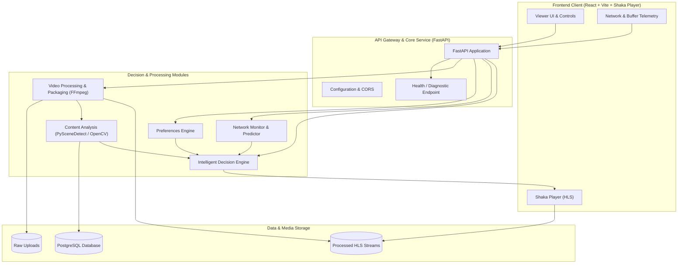

# StreamWise Architecture Documentation

StreamWise is an intelligent video streaming optimization system designed to deliver high-perceived-quality video while minimizing bandwidth consumption and rebuffering events. Unlike traditional Adaptive Bitrate (ABR) algorithms that react solely to throughput and buffer levels, StreamWise incorporates video content complexity and viewer preferences to make granular, segment-level quality decisions.

---

## 1. System Architecture Overview



---

## 2. Component Implementation Status

| Component | Path | Current Status | Primary Responsibility |
| :--- | :--- | :--- | :--- |
| **Backend Core** | `backend/app/main.py` | **Implemented** | FastAPI application initialization, CORS configuration, base routing. |
| **Config Service** | `backend/app/config/` | **Implemented** | Environment-based configuration management (`pydantic-settings`). |
| **Health API** | `backend/app/main.py` | **Implemented** | Application health status (`GET /api/health`). |
| **Storage Structure** | `storage/` | **Implemented** | Root directory tracking for raw uploads and processed media outputs. |
| **Video Processing (Upload/Validation/Metadata)** | `backend/app/modules/video_processing/` | **Implemented** | Multipart upload streaming, format/MIME validation, FFprobe metadata extraction, storage layout. |
| **Video Processing (Transcoding/Segmentation)** | `backend/app/modules/video_processing/` | *Planned* | FFmpeg multi-bitrate ladder transcoding, HLS packaging, manifest authoring. |
| **Content Analysis** | `backend/app/modules/content_analysis/` | *Planned* | Scene detection, motion estimation, spatial/temporal complexity scoring. |
| **Preferences** | `backend/app/modules/preferences/` | *Planned* | User preference profiles (Data Saver, Quality Priority, Balanced). |
| **Network Monitor** | `backend/app/modules/network_monitor/` | *Planned* | Telemetry ingestion, bandwidth estimation, throughput smoothing. |
| **Decision Engine** | `backend/app/modules/decision_engine/` | *Planned* | Segment-level quality allocation and dynamic manifest delivery. |
| **Database** | `backend/app/database/` | *Planned* | PostgreSQL schema, migrations, video/segment metadata persistence. |
| **Storage Service** | `backend/app/storage/` | *Planned* | Abstraction layer for file access, upload chunking, and retention. |
| **Frontend** | `frontend/` | *Planned* | React/Vite dashboard, Shaka Player client, live telemetry visualization. |

---

## 3. Implemented Components (Current Phase)

### 3.1 Backend Application Core (`backend/app/main.py`)
- Initializes the central FastAPI application named `StreamWise`.
- Sets up standard Cross-Origin Resource Sharing (CORS) middleware to facilitate local development alongside modern frontends (e.g., Vite dev server on port `5173`).
- Houses the initial diagnostic endpoint `GET /api/health`.

### 3.2 Configuration Management (`backend/app/config/settings.py`)
- Built using `pydantic-settings` to provide typed, validated settings.
- Automatically reads from environment variables and `.env` files with sensible fallbacks.
- Exposes parameters such as `APP_NAME`, `APP_VERSION`, `DEBUG`, `STORAGE_DIR`, `MAX_UPLOAD_SIZE_MB`, and `FRONTEND_URL`.

### 3.3 Diagnostic Health Endpoint (`GET /api/health`)
- Returns a lightweight JSON payload verifying service health:
  ```json
  {
    "application": "StreamWise",
    "status": "healthy",
    "version": "0.1.0"
  }
  ```

### 3.4 Storage Repository (`storage/`)
- Directory structure providing isolated workspaces:
  - `storage/uploads/`: Landing directory for incoming raw video files.
  - `storage/processed/`: Working directory for transcoded streams, HLS manifests (`.m3u8`), and media segments (`.ts`).
  - Directories are tracked via `.gitkeep` with media artifacts ignored by `.gitignore`.

### 3.5 Video Upload, Validation & Metadata Pipeline (`backend/app/modules/video_processing/`)
- **API Endpoint**: `POST /api/videos/upload` mounted via `backend/app/api/video_routes.py`.
- **Chunked Stream Uploader (`uploader.py`)**: Streams incoming video data in 1 MB chunks to disk (`storage/uploads/{video_id}/source.{ext}`), enforcing `MAX_UPLOAD_SIZE_MB` limits and rejecting 0-byte uploads without loading whole files into memory. Automatically rolls back and purges partial files upon error.
- **Format Validator (`validator.py`)**: Enforces extension allowlist (`.mp4`, `.mov`, `.mkv`, `.webm`) and performs preliminary MIME type filtering.
- **FFprobe Metadata Extractor (`metadata.py`)**: Safely executes FFprobe via subprocess with argument lists (`shell=False`), timeout safety, and zero shell interpolation. Extracts technical attributes including duration, dimensions, resolution, frame rate, video codec, audio codec, container formats, bitrate, and byte size.
- **Service Coordinator (`service.py`)**: Orchestrates validation, chunked upload, FFprobe extraction, and builds structured Pydantic response records (`VideoUploadResponse`).

---

## 4. Planned Components (Future Modules)

### 4.1 Video Processing Module (`backend/app/modules/video_processing/`)
- **FFmpeg / FFprobe Wrappers**: Execute container inspection, audio/video stream extraction, keyframe positioning, and multi-bitrate encoding ladders.
- **HLS Segmenter**: Generate standardized segment durations (e.g., 2s, 4s, or 6s) aligned with GOP boundaries.

### 4.2 Content Analysis Module (`backend/app/modules/content_analysis/`)
- **Scene Detection**: Utilize PySceneDetect to detect scene cuts and transitions, preventing quality jumps mid-scene.
- **Complexity Extraction**: Compute spatial and temporal complexity metrics using OpenCV:
  - *Spatial Information (SI)*: Measures frame detail, texture, and edge energy.
  - *Temporal Information (TI)*: Measures motion vectors and difference energy across consecutive frames.
- **Segment Metadata**: Generates a complexity profile per segment used by the decision engine.

### 4.3 Preferences Module (`backend/app/modules/preferences/`)
- Stores user-defined optimization modes:
  - **Data Saver**: Aggressive bitrate caps, acceptable lower fidelity on high-complexity scenes.
  - **Quality Priority**: Maximizes fidelity on high-complexity scenes, relaxing bandwidth constraints.
  - **Smooth Playback**: Prioritizes rebuffering avoidance under volatile network conditions.

### 4.4 Network Monitor Module (`backend/app/modules/network_monitor/`)
- Collects continuous playback telemetry from the client (throughput, latency, round-trip time, dropped frames, buffer length).
- Employs smoothing filters (e.g., EWMA, harmonic mean) to forecast available throughput for upcoming segments.

### 4.5 Intelligent Decision Engine (`backend/app/modules/decision_engine/`)
- The central brain of StreamWise.
- Takes as inputs:
  1. Upcoming segment complexity (from Content Analysis).
  2. Network throughput forecasts (from Network Monitor).
  3. Viewer streaming policy (from Preferences).
  4. Current buffer health (from Player Telemetry).
- Allocates the optimal bitrate/resolution for each individual segment, avoiding unnecessary bandwidth waste on static/low-complexity scenes while investing bits where visual artifacts would otherwise be noticeable.

### 4.6 Database Layer (`backend/app/database/`)
- PostgreSQL database integrated via SQLAlchemy or SQLModel.
- Stores user profiles, video metadata, segment complexity index maps, and session telemetry logs.

### 4.7 Frontend Application (`frontend/`)
- Single-page application built with React, Vite, and Tailwind CSS.
- Integrates **Shaka Player** to execute HLS playback, instrumented with custom ABR logic and real-time telemetry streaming back to the FastAPI backend.
